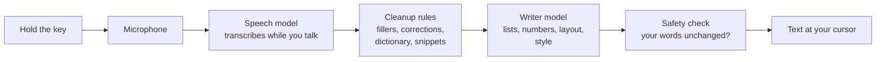

<div align="center">


<h1>Kudu</h1>

<p><b>Voice dictation that runs entirely on your computer.</b><br />
Hold a key, speak, release. Clean, formatted text appears at your cursor, in any app.</p>

<p>
<a href="https://github.com/manasdutta04/kudu/releases/latest"></a>
<a href="https://github.com/manasdutta04/kudu/actions/workflows/ci.yml"></a>
<a href="https://github.com/manasdutta04/kudu/releases"></a>
<a href="LICENSE"></a>
</p>

<p>
<a href="#install"></a>
<a href="#install"></a>
<a href="#install"></a>
<a href="https://github.com/manasdutta04/kudu/stargazers"></a>
<a href="CONTRIBUTING.md"></a>
</p>

<p>
<a href="https://github.com/manasdutta04/kudu/releases/latest"><b>Download</b></a>
&nbsp;·&nbsp; <a href="#why-kudu">Why Kudu</a>
&nbsp;·&nbsp; <a href="#the-models">The models</a>
&nbsp;·&nbsp; <a href="#faq">FAQ</a>
&nbsp;·&nbsp; <a href="docs/ROADMAP.md">Roadmap</a>
&nbsp;·&nbsp; <a href="CONTRIBUTING.md">Contribute</a>
</p>

<br />


</div>

<br />

## Install

<table>
  <tr>
    <th width="200" align="left">Platform</th>
    <th align="left">Status</th>
    <th align="left">Requirements</th>
    <th align="left">Install with one command</th>
  </tr>
  <tr>
    <td>
      <picture>
        <source media="(prefers-color-scheme: dark)" srcset="public/icons/apple-dark.svg" />
        
      </picture>
      &nbsp;<b>macOS</b>
    </td>
    <td>Stable</td>
    <td>Apple Silicon (M1 or newer), macOS 14+</td>
    <td><code>curl -fsSL https://github.com/manasdutta04/kudu/releases/latest/download/install-macos.sh | bash</code></td>
  </tr>
  <tr>
    <td>&nbsp;<b>Windows</b></td>
    <td>Stable</td>
    <td>Windows 10 or 11, x64</td>
    <td><code>irm https://github.com/manasdutta04/kudu/releases/latest/download/install.ps1 | iex</code></td>
  </tr>
  <tr>
    <td>&nbsp;<b>Linux</b></td>
    <td>Beta</td>
    <td>x86_64, X11 or Wayland</td>
    <td><code>curl -fsSL https://github.com/manasdutta04/kudu/releases/latest/download/install.sh | sh</code></td>
  </tr>
</table>

Prefer a package? The [latest release](https://github.com/manasdutta04/kudu/releases/latest) has a
`.dmg` for macOS, a setup `.exe` and portable `.zip` for Windows, and `.deb` and `.rpm` for Linux.

<details>
<summary><b>First-launch notes for each platform</b></summary>
<br />

Kudu isn't signed with paid certificates yet. The one-line installers take care of the warnings;
if you install by hand:

- **macOS:** after dragging Kudu from the `.dmg`, run
  `chmod -R u+w /Applications/Kudu.app && xattr -cr /Applications/Kudu.app` once. Kudu then asks
  for Microphone and Accessibility access.
- **Windows:** when SmartScreen appears, click **More info → Run anyway**. For the portable zip,
  run `Unblock-File .\kudu.exe` in its folder.
- **Linux:** the installer asks for `sudo` once to add you to the `input` group and install a udev
  rule, so Kudu can read the keyboard and type on both X11 and Wayland. Log out and back in afterwards.

On first launch, pick a model (see [The models](#the-models)). It downloads once, is checked
against its sha256 checksum, and from then on Kudu works offline.
</details>

## Why Kudu

Popular dictation apps either stream your voice to their servers or lock the good parts behind a
subscription. Kudu was built to show you don't need either: speech recognition, formatting and
rewriting all run locally, fast enough that the text is there the moment you let go of the key.

| | **Kudu** | Wispr Flow | Superwhisper |
|---|:---:|:---:|:---:|
| Speech recognition on your computer | ✅ | ❌ | ✅ |
| Formatting and rewriting on your computer | ✅ | ❌ | Depends on the model you pick |
| Works with no internet connection | ✅ | ❌ | ✅ |
| Open source | ✅ | ❌ | ❌ |
| Price | **Free** | Free tier, $15/mo Pro | Free tier, $8.49/mo Pro |
| macOS and Windows | ✅ | ✅ | ✅ |
| Linux | ✅ | ❌ | ❌ |
| Meeting notes written on your computer | ✅ | ❌ | ❌ |
| Its own fine-tuned formatting models, published openly | ✅ | ❌ | ❌ |

<sub>Based on each product's public website, October 2026. If something here is out of date,
please <a href="https://github.com/manasdutta04/kudu/issues/new/choose">open an issue</a>.</sub>

## What it does

<table>
  <tr>
    <td width="50%" valign="top">
      <h4>Dictate anywhere</h4>
      Hold the shortcut in any text field: email, chat, documents, the browser, your editor or the
      terminal. Double-tap for hands-free, and press Escape to cancel. Kudu inserts through the
      platform's accessibility APIs and falls back to a clipboard paste, then puts your clipboard back.
    </td>
    <td width="50%" valign="top">
      <h4>Formats while you speak</h4>
      Numbered lists, times ("three thirty" → 3:30), written numbers, paragraphs and email layout,
      without rewording you. Filler words disappear and spoken corrections apply:
      "Tuesday, no, Wednesday" → "Wednesday". Capitalization and spacing fit the text around the cursor.
    </td>
  </tr>
  <tr>
    <td valign="top">
      <h4>Command mode</h4>
      Select text and say "make this more formal", "translate to Hindi" or "summarize". With nothing
      selected, say what you need and Kudu drafts it in place.
    </td>
    <td valign="top">
      <h4>Your voice, your style</h4>
      Formal, casual or very casual, set separately for personal messages, work chat and email, with
      an editing strength from Verbatim to Polished. Code-aware in editors and terminals.
    </td>
  </tr>
  <tr>
    <td valign="top">
      <h4>Learns your words</h4>
      Fix a name Kudu got wrong and it remembers next time. Add your own vocabulary, and snippets
      like "my email" that expand to your address, with <code>{date}</code>, <code>{time}</code>
      and <code>{clipboard}</code>.
    </td>
    <td valign="top">
      <h4>Meeting notes</h4>
      Off until you turn it on. Kudu transcribes Zoom, Teams, Meet, Webex, Slack or FaceTime calls,
      labels "You" and "Others", and writes the title, summary, decisions and action items when the
      call ends. The audio is never saved; export notes as Markdown.
    </td>
  </tr>
  <tr>
    <td valign="top">
      <h4>Insights and history</h4>
      Words per minute, time saved, words cleaned up, a streak heat map and the apps you dictate
      into most, plus searchable history with the raw transcript for every dictation.
    </td>
    <td valign="top">
      <h4>Native on every platform</h4>
      A Swift, SwiftUI and AppKit app on the Mac with an animated menu-bar icon; a Rust app on
      Windows and Linux with a tray icon and a live waveform overlay. On macOS and Windows, updates install in one click.
    </td>
  </tr>
</table>

### Default shortcuts

| Action | macOS | Windows | Linux |
|---|---|---|---|
| Dictate (hold) | <kbd>fn</kbd> | <kbd>Ctrl</kbd> + <kbd>Win</kbd> | <kbd>Ctrl</kbd> + <kbd>Super</kbd> |
| Hands-free | Double-tap the dictate key | Double-tap | Double-tap |
| Command mode (hold) | <kbd>fn</kbd> + <kbd>⌃</kbd> | <kbd>Ctrl</kbd> + <kbd>Win</kbd> + <kbd>Alt</kbd> | <kbd>Ctrl</kbd> + <kbd>Super</kbd> + <kbd>Alt</kbd> |
| Paste last transcript | <kbd>⌃</kbd> + <kbd>⌘</kbd> + <kbd>V</kbd> | <kbd>Ctrl</kbd> + <kbd>Alt</kbd> + <kbd>V</kbd> | <kbd>Ctrl</kbd> + <kbd>Alt</kbd> + <kbd>V</kbd> |
| Start or stop meeting notes | <kbd>⌃</kbd> + <kbd>⌥</kbd> + <kbd>N</kbd> | <kbd>Ctrl</kbd> + <kbd>Alt</kbd> + <kbd>N</kbd> | <kbd>Ctrl</kbd> + <kbd>Alt</kbd> + <kbd>N</kbd> |
| Cancel | <kbd>Esc</kbd> | <kbd>Esc</kbd> | <kbd>Esc</kbd> |

Every shortcut can be changed in Settings.

## How it works



1. **Speech to text, while you talk.** Kudu transcribes and formats in the background as you
   speak, instead of waiting for you to finish, so only the last few words are left when you
   release the key.
2. **Deterministic cleanup.** Fast, fully tested rules remove fillers, apply spoken corrections,
   "new line" and "new paragraph", your dictionary and snippets. The same rules exist in Swift
   and in Rust, so every platform behaves the same.
3. **Formatting by a small language model,** only when the text needs structure (a list, numbers
   in words, a letter). Plain sentences skip it entirely.
4. **A safety check** compares the formatted result with what you said and keeps your original
   words if the model changed them.
5. **Insertion** through Accessibility on macOS, UI Automation on Windows and AT-SPI on Linux,
   with a clipboard-paste fallback everywhere.

The result: text lands about **100–700 ms** after you release the key, even for long, formatted
dictations (measured on an Apple M4).

## The models

Kudu downloads its models once, checks each against a pinned sha256 checksum, and runs them on
your own hardware. They are English-only for now.

### macOS

| Model | Size | What it is | Runs on |
|---|---|---|---|
| **Kudu Tiny** | ~230 MB | NVIDIA Parakeet TDT-CTC 110M, Core ML conversion by FluidInference | Apple Neural Engine |
| **Kudu Base** | ~450 MB | NVIDIA Parakeet TDT 0.6B v2, Core ML conversion by FluidInference | Apple Neural Engine |
| Formatting and Command mode | none to download | Apple Intelligence (Apple's on-device Foundation Models, macOS 26+) | Apple silicon |

On macOS 14 and 15, dictation and cleanup work fully; smart formatting and Command mode need macOS 26.

### Windows and Linux

On Windows and Linux you pick one **model pack** at setup: a speech model and a writer model that
download together.

| Pack | Speech model | Writer model | Download | On disk |
|---|---|---|---|---|
| Kudu Tiny | kudu-speech-tiny | kudu-writer-tiny | 0.48 GB | 0.50 GB |
| **Kudu Base** (default) | kudu-speech-base | kudu-writer-tiny | 0.71 GB | 0.86 GB |
| Kudu Large | kudu-speech-base | kudu-writer-base | 0.84 GB | 0.98 GB |

| Model | Based on | Format | Runtime | License |
|---|---|---|---|---|
| kudu-speech-tiny | Moonshine Base (English) | ONNX, int8 | sherpa-onnx, CPU | MIT |
| kudu-speech-base | NVIDIA Parakeet TDT 0.6B v2 | ONNX, int8 | sherpa-onnx, CPU | CC-BY-4.0 |
| [kudu-writer-tiny](https://huggingface.co/manasdutta04/kudu-writer-tiny) | SmolLM2-360M-Instruct | GGUF, IQ4_XS (227 MB) | llama.cpp, CPU | Apache-2.0 |
| [kudu-writer-base](https://huggingface.co/manasdutta04/kudu-writer-base) | Qwen2.5-0.5B-Instruct | GGUF, Q4_0 (353 MB) | llama.cpp, CPU | Apache-2.0 |

You can switch packs and remove the ones you don't use in **Settings → Models**.

### The Kudu writers

The writers are Kudu's own models, fine-tuned for a single job: formatting dictation and running
Command mode without changing your words. On Kudu's dictation test set:

| | Kudu writer | General-purpose model of the same size |
|---|:---:|:---:|
| Replies that pass the safety check | **~98%** | ~80% |
| Time to format a 50-word dictation on a laptop CPU | **~1 s** | |

Both are published on Hugging Face under Apache-2.0, so you can inspect or reuse them.

## Privacy

Kudu has no servers, no accounts and no API keys. It connects to the internet for two things only:

- **The one-time model download** from GitHub and Hugging Face.
- **A daily update check** that asks GitHub for the latest version number. Updates install only
  when you click Install.

There's no telemetry, no analytics and no crash reporting. Your history, dictionary, insights and
meeting notes are stored on your computer and deleted when you delete them. Read the full
[privacy policy](PRIVACY.md).

## Build from source

```bash
git clone https://github.com/manasdutta04/kudu.git
cd kudu
```

<table>
  <tr>
    <th align="left">macOS app (Swift)</th>
    <th align="left">Windows and Linux app (Rust)</th>
  </tr>
  <tr>
    <td valign="top">

```bash
cd macos
swift test
scripts/build-app.sh
open build/Kudu.app
```
Needs only the Xcode Command Line Tools.
See [macos/README.md](macos/README.md).

</td>
    <td valign="top">

```bash
cd desktop
cargo test --workspace
cargo build --release
./target/release/kudu
```
Needs Rust stable and CMake.
See [desktop/README.md](desktop/README.md).

</td>
  </tr>
</table>

### Repository layout

| Path | What's inside |
|---|---|
| [`macos/`](macos) | The Mac app: `KuduCore` (pure text pipeline), `KuduKit` (system integration), `Kudu` (UI), `KuduBench` (latency harness). See the [architecture](macos/ARCHITECTURE.md). |
| [`desktop/`](desktop) | The Windows and Linux app: `kudu-core` (the same pipeline in Rust), `kudu-engine` (speech and writer), `kudu-app` (UI and platform code), plus installers |
| [`docs/`](docs) | Project-wide docs and the [roadmap](docs/ROADMAP.md) |
| [`.github/`](.github) | CI, release workflow, issue forms and branch rules |

## Roadmap

Coming next:

- Notarized macOS builds, a Homebrew cask, and winget and Flatpak packages
- Your personal dictionary biasing the speech model itself
- Undo the last dictation, and spoken editing commands like "press enter"
- Confirming every paste landed, with a clear message when it didn't
- Published latency and accuracy benchmarks

See the full [roadmap](docs/ROADMAP.md) and the [changelog](CHANGELOG.md).

## FAQ

<details>
<summary><b>Is Kudu really free?</b></summary>
<br />
Yes. Kudu is MIT-licensed open source with no paid tier, no usage limits and no account.
</details>

<details>
<summary><b>Does it work offline?</b></summary>
<br />
Yes. After the one-time model download, dictation, formatting, Command mode and meeting notes
all work with no internet connection.
</details>

<details>
<summary><b>Which languages does it support?</b></summary>
<br />
English today. Command mode can translate what you've written into other languages, such as Hindi.
</details>

<details>
<summary><b>Does it work on Intel Macs?</b></summary>
<br />
No. The Mac app relies on the Apple Neural Engine and needs an M1 or newer.
</details>

<details>
<summary><b>Why does my computer warn about an unidentified developer?</b></summary>
<br />
The builds aren't signed with paid certificates yet. The one-line installers clear the warning,
and notarized builds are on the roadmap. You can always build Kudu from source.
</details>

<details>
<summary><b>Why is Linux still in beta?</b></summary>
<br />
Linux desktops differ a lot (X11, Wayland, GNOME, KDE, wlroots). Kudu works on all of them, but
it needs more testing across distributions. Reports from your setup help a lot.
</details>

## Contributing

Bug reports, cleanup rules, platform fixes and docs are all welcome.

- Read the [contributing guide](CONTRIBUTING.md) and the [code of conduct](CODE_OF_CONDUCT.md).
- Report a bug, wrong text or an idea through the [issue forms](https://github.com/manasdutta04/kudu/issues/new/choose).
- Report security problems privately, as described in [SECURITY.md](SECURITY.md).

## Acknowledgements

Kudu is built on excellent open work:
[NVIDIA Parakeet](https://huggingface.co/nvidia/parakeet-tdt-0.6b-v2),
[Moonshine](https://huggingface.co/moonshine-ai/moonshine-base),
[SmolLM2](https://huggingface.co/HuggingFaceTB/SmolLM2-360M-Instruct),
[Qwen2.5](https://huggingface.co/Qwen/Qwen2.5-0.5B-Instruct),
[FluidAudio](https://github.com/FluidInference/FluidAudio),
[sherpa-onnx](https://github.com/k2-fsa/sherpa-onnx),
[llama.cpp](https://github.com/ggml-org/llama.cpp) and
[Devicon](https://github.com/devicons/devicon) for the platform icons.

## License

[MIT](LICENSE) © 2026 [Manas Dutta](https://github.com/manasdutta04)

<br />

<div align="center">
<sub>Designed and built by <a href="https://github.com/manasdutta04"><b>Manas Dutta</b></a>.
If Kudu saves you time, starring the repo helps others find it.</sub>
</div>
